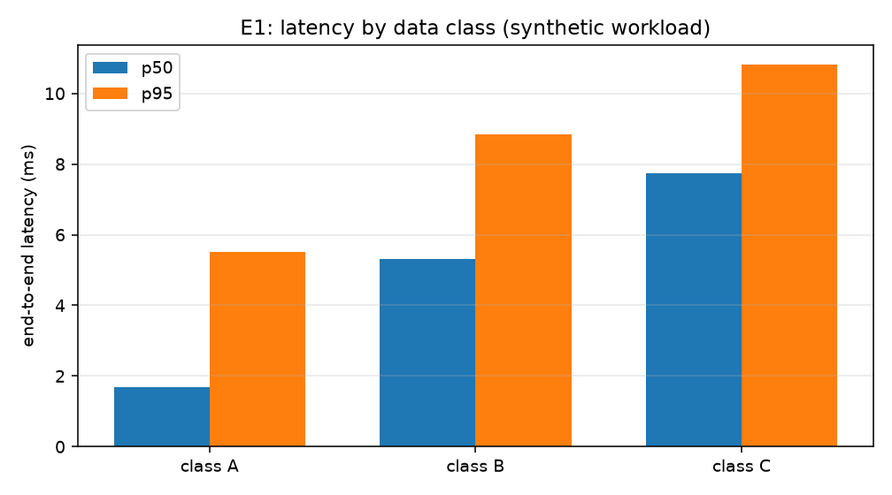
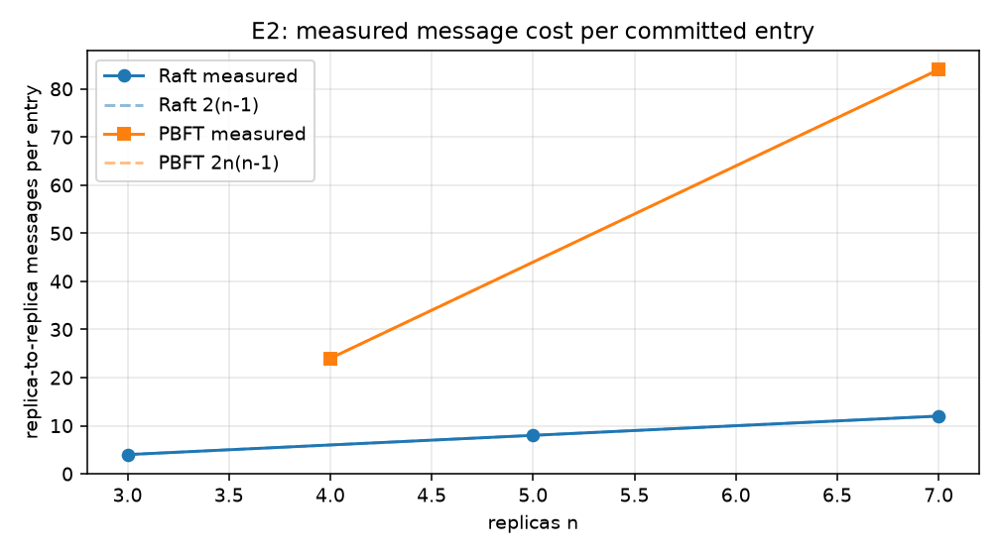
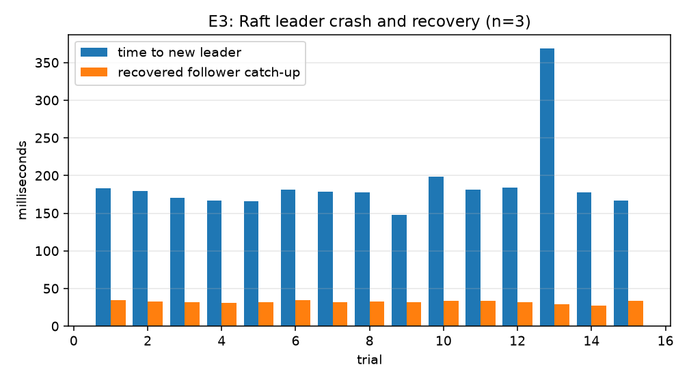
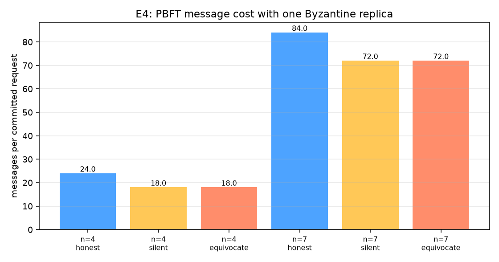
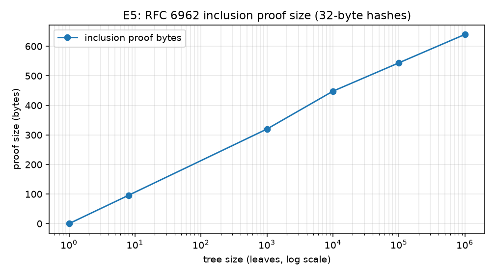
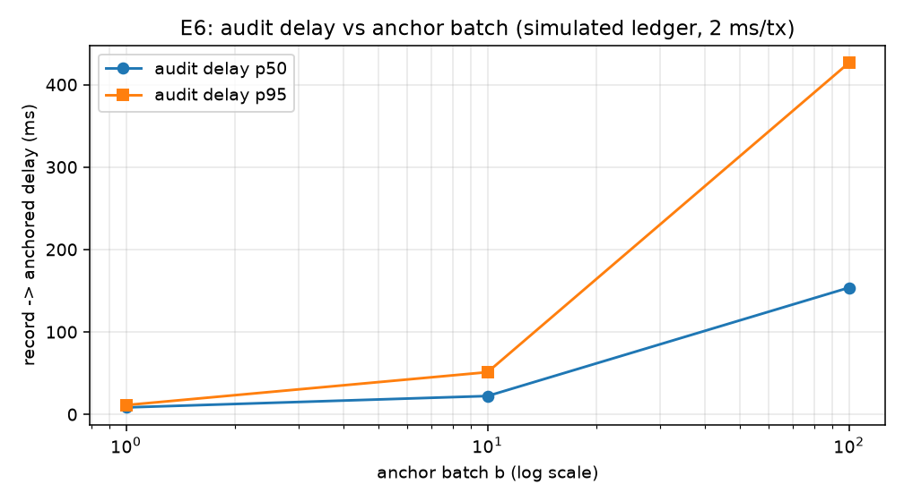

# DIMF prototype — measured results

> **Synthetic data only.** Every number below was produced by an actual run of
> this repository on the machine described here. The workload is generated
> (`src/dimf/eval/workload.py`), the network is simulated in one Python process,
> and none of this is a real government deployment or a production benchmark.

- Generated: 2026-11-25 20:57:46
- Mode: **full** (`make bench -- --quick` for quick, `make bench` for full)
- Total wall clock: **25.7 s**
- Python: 3.14.10 on Linux-6.18.63-3-lts-x86_64-with-glibc2.44
- CPU count: 16
- Ledger backend: simulated hash-chained SQLite (no EVM was used)
- Seed: 20261125; record schema and synthetic markers in `docs/ARCHITECTURE.md`

## Headline measurements

- E1 overall: **165.981 records/s**, p50 **5.053 ms**, p95 **9.919 ms** for 600 sequential synthetic submissions.
- E2 PBFT: **84 messages** for n=7 at one committed entry, matching the normal-case formula 2n(n-1) = **84**.
- E2 Raft: **4 messages** for n=3, matching 2(n-1) = **4**.
- E5 Merkle: at **m = 1,000,000** leaves the worst-case inclusion proof (index 0) has **20 hashes = 640 bytes** (ceil(log2 m) = 20); the last leaf is shallower at 12 hashes. Tree build 1201.8 ms, verification 9.5307 ms.
- E3 Raft failover: new leader in p50 **178.12 ms** / p95 **368.568 ms**; recovered follower catch-up p50 **31.976 ms** over 15 trials.
- E4 PBFT: all scenarios committed and all honest orders agreed: **True** / **True**.
- E6 tamper: **20/20** modified stored records failed inclusion verification; the root recomputed from the database no longer matched the signed root: **True**.

## E1 — end-to-end latency and throughput by data class

Path exercised: signed submission -> L1 placement/blob decision -> L2
(CRDT/Raft/PBFT) -> L3 signed Merkle log. Latency is measured inside the
process from the start of L1 routing to the end of the L3 append. The
network latency is simulated at 0.3 ms per hop.

| mode | scope | n | throughput_rps | p50_ms | p95_ms | p99_ms | mean_ms | avg_messages_per_entry |
|---|---|---|---|---|---|---|---|---|
| full | all | 600 | 165.981 | 5.053 | 9.919 | 11.761 | 5.444 | 10.03 |
| full | A | 200 | 55.327 | 1.673 | 5.517 | 7.146 | 3.043 | 0.0 |
| full | B | 200 | 55.327 | 5.308 | 8.847 | 9.592 | 5.723 | 5.54 |
| full | C | 200 | 55.327 | 7.738 | 10.83 | 14.262 | 7.567 | 24.54 |



**Reading this honestly:** throughput is *sequential* submissions from one
asyncio task, so it measures request latency, not maximum server throughput.
The Raft path is the slowest because every entry needs a majority round-trip.
CRDT writes have no coordination messages but still pay L3 append cost.

## E2 — protocol messages per committed entry

Counts come from the simulated network's per-protocol counter. For Raft the
counter was reset after the election and heartbeats were suppressed for the
measured append, so the count is exactly the append traffic. PBFT counts only
replica-to-replica PRE-PREPARE / PREPARE / COMMIT messages.

| protocol | n | scenario | messages | expected_formula | expected | matches |
|---|---|---|---|---|---|---|
| raft | 3 | one committed entry, heartbeats suppressed | 4 | 2(n-1) | 4 | True |
| raft | 5 | one committed entry, heartbeats suppressed | 8 | 2(n-1) | 8 | True |
| raft | 7 | one committed entry, heartbeats suppressed | 12 | 2(n-1) | 12 | True |
| pbft | 4 | one committed entry, all replicas honest | 24 | 2n(n-1) | 24 | True |
| pbft | 7 | one committed entry, all replicas honest | 84 | 2n(n-1) | 84 | True |
| crdt | 3 | 100 local writes (no coordination) | 0 | 0 | 0 | True |
| crdt | 3 | one full gossip round after writes | 6 | n(n-1) | 6 | True |



**Reading this honestly:** this is a message *count*, not bytes or bandwidth.
The simulated network delivers in-process messages; a real implementation adds
serialisation, TLS, retries and WAN effects. CRDT has zero write-coordination
messages, but gossip still costs messages and eventual consistency is weaker
than the other two protocols.

## E3 — Raft leader crash and recovery

Each trial: elect a leader, commit two entries, crash the leader, wait for a
new leader, commit one more entry, recover the old leader and wait until it
has caught up. n = 3 with a 30 ms heartbeat and 120–220 ms election timeout.

| mode | trial | old_leader | new_leader | new_term | election_ms | failover_append_ok | recovered_role | catchup_ms |
|---|---|---|---|---|---|---|---|---|
| full | 1 | raft-0 | raft-1 | 2 | 183.297 | True | follower | 34.07 |
| full | 2 | raft-0 | raft-2 | 2 | 179.877 | True | follower | 33.002 |
| full | 3 | raft-2 | raft-1 | 2 | 170.399 | True | follower | 31.426 |
| full | 4 | raft-0 | raft-2 | 2 | 166.914 | True | follower | 30.963 |
| full | 5 | raft-1 | raft-2 | 2 | 165.917 | True | follower | 31.736 |
| full | 6 | raft-1 | raft-2 | 2 | 181.416 | True | follower | 34.506 |
| full | 7 | raft-0 | raft-2 | 2 | 178.12 | True | follower | 31.439 |
| full | 8 | raft-0 | raft-1 | 2 | 177.185 | True | follower | 32.655 |
| full | 9 | raft-2 | raft-1 | 2 | 147.942 | True | follower | 31.976 |
| full | 10 | raft-1 | raft-0 | 2 | 198.637 | True | follower | 33.615 |
| full | 11 | raft-0 | raft-2 | 2 | 181.593 | True | follower | 33.633 |
| full | 12 | raft-1 | raft-2 | 2 | 184.042 | True | follower | 31.794 |
| full | 13 | raft-0 | raft-2 | 3 | 368.568 | True | follower | 28.734 |
| full | 14 | raft-1 | raft-0 | 2 | 177.331 | True | follower | 27.584 |
| full | 15 | raft-2 | raft-0 | 2 | 166.687 | True | follower | 33.261 |



**Reading this honestly:** a single process means "crash" is a flag, not a
process kill, so no OS scheduling or TCP reconnect delay is modelled. The
timings are dominated by the simulated election timeout, and no snapshots or
log compaction exist.

## E4 — PBFT with one Byzantine replica

n = 4 (f = 1) and n = 7 (f = 2). `silent` means the replica stops sending;
`equivocate` means it sends conflicting PREPARE/COMMIT messages.

| mode | n | f | scenario | requests | committed | orders_agree | messages | messages_per_committed_request | normal_formula_total |
|---|---|---|---|---|---|---|---|---|---|
| full | 4 | 1 | honest | 10 | 10 | True | 240 | 24.0 | 240 |
| full | 4 | 1 | silent | 10 | 10 | True | 180 | 18.0 | 240 |
| full | 4 | 1 | equivocate | 10 | 10 | True | 180 | 18.0 | 240 |
| full | 7 | 2 | honest | 10 | 10 | True | 840 | 84.0 | 840 |
| full | 7 | 2 | silent | 10 | 10 | True | 720 | 72.0 | 840 |
| full | 7 | 2 | equivocate | 10 | 10 | True | 720 | 72.0 | 840 |



**Reading this honestly:** there is no view change. A Byzantine *primary* is
therefore not tolerated, which is a real gap (documented in
`docs/CHALLENGES.md`). The silent case uses fewer messages than the normal-case
formula because the faulty replica contributes nothing.

## E5 — Merkle proof scaling and the 10^6 case

RFC 6962 hashing (`SHA-256(0x00 || leaf)` and `SHA-256(0x01 || left || right)`),
inclusion and consistency proofs, verified with the same verifier that ships
to auditors.

| mode | leaves | build_ms | proof_index | proof_hashes | proof_bytes | last_leaf_proof_hashes | last_leaf_proof_bytes | verify_ms_mean | expected_hashes_ceil_log2 | consistency_hashes |
|---|---|---|---|---|---|---|---|---|---|---|
| full | 1 | 0.0 | 0 | 0 | 0 | 0 | 0 | 0.0006 | 0 | 0 |
| full | 8 | 0.0 | 0 | 3 | 96 | 3 | 96 | 0.002 | 3 | 1 |
| full | 1000 | 1.2 | 0 | 10 | 320 | 8 | 256 | 0.0068 | 10 | 9 |
| full | 10000 | 11.8 | 0 | 14 | 448 | 8 | 256 | 0.0249 | 14 | 12 |
| full | 100000 | 119.9 | 0 | 17 | 544 | 10 | 320 | 0.2114 | 17 | 14 |
| full | 1000000 | 1201.8 | 0 | 20 | 640 | 12 | 384 | 9.5307 | 20 | 16 |



**Reading this honestly:** the tree is held in memory and built leaf by leaf.
The proof is logarithmic: at 10^6 leaves the worst-case audit path (index 0)
is only
**20 hashes / 640 bytes**,
and the shallowest leaf (the last one) needs
**12 hashes / 384 bytes**.
RFC 6962 does **not** pad the tree to a power of two, so proof length varies by
position; the table records both. Build time is Python-bound and is not a
claim about production log throughput.

## E6 — anchoring cadence, audit delay and tamper detection

`Audit delay` is the time from a record being inserted until the batch
containing it is anchored; the ledger costs 2 ms per transaction.

| mode | anchor_batch | records | ledger_latency_ms | transactions | expected_transactions_ceil_n_over_b | pending_after_flush | audit_p50_ms | audit_p95_ms | append_total_ms | append_mean_ms |
|---|---|---|---|---|---|---|---|---|---|---|
| full | 1 | 400 | 2.0 | 400 | 400 | 0 | 8.43 | 11.277 | 4717.7 | 11.794 |
| full | 10 | 400 | 2.0 | 40 | 40 | 0 | 22.267 | 51.177 | 1853.5 | 4.634 |
| full | 100 | 400 | 2.0 | 4 | 4 | 0 | 153.716 | 426.477 | 1496.1 | 3.74 |



Tamper experiment: stored SQLite record content was modified without touching
the Merkle tree or signed head.

| mode | records | tampered | detected | detection_rate_pct | clean_record_still_valid | recomputed_root_mismatch |
|---|---|---|---|---|---|---|
| full | 200 | 20 | 20 | 100.0 | True | True |

**Reading this honestly:** a larger batch reduces ledger transactions and cost
but increases audit delay (the trade-off the framework exposes). The simulated
ledger is a local SQLite hash chain, not a public blockchain. The tamper button
and endpoint are demo-only.

## What was measured, what was simulated, what is out of scope

| Area | Status in this delivery |
|---|---|
| CRDT class A | Implemented (G-counter + LWW register, gossip, partition convergence) |
| Raft class B | Implemented (election, replication, commit, crash/recover) — **no snapshots** |
| PBFT class C | Implemented for n = 3f+1, f = 1 default — **no view change** |
| Merkle log | Implemented exact RFC 6962 shape, inclusion + consistency proofs |
| Ed25519 signatures | Implemented (agency submissions + signed tree heads) |
| Anchoring | Implemented with simulated SQLite ledger; EVM backend optional, see `docs/EVM.md` |
| Network | **Simulated** in one Python process; no real sockets, TLS or WAN |
| Workload | **Synthetic**; amounts in paise, no real beneficiaries or agencies |
| Production hardening | **Out of scope** (no auth server, no rate limits, no HA, no backups) |

## Reproduce

```bash
make install
make bench -- --quick     # under 2 minutes on the development machine
make bench                # full run
```

Raw data: `results/*.csv`. Charts: `results/*.png`. This file is regenerated
by each run, so the numbers always correspond to the committed scripts.
